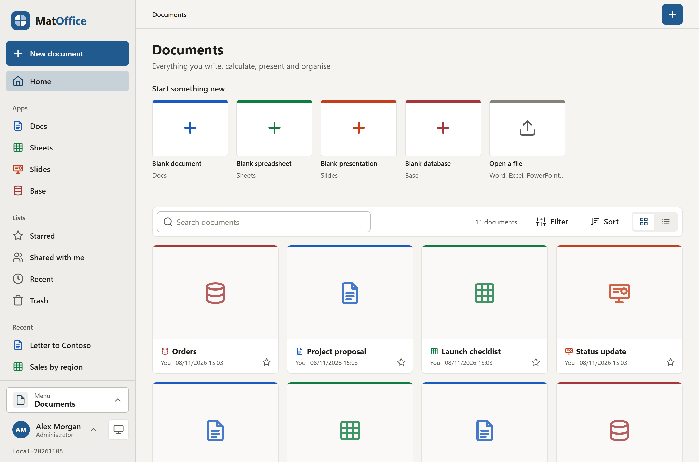
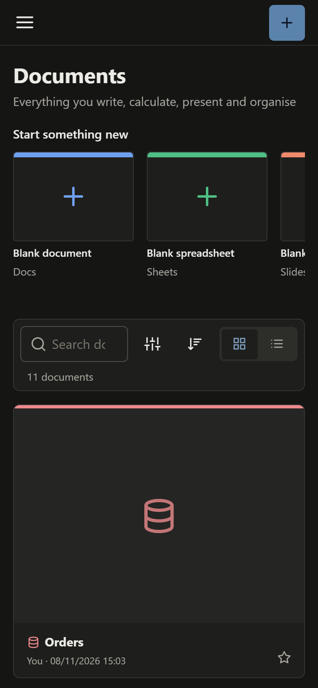
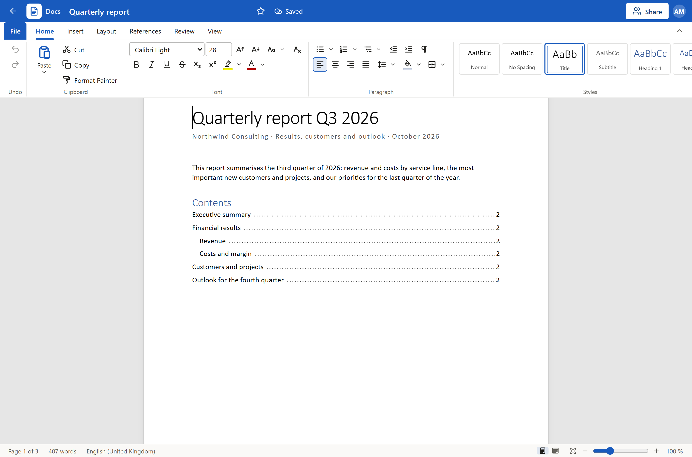
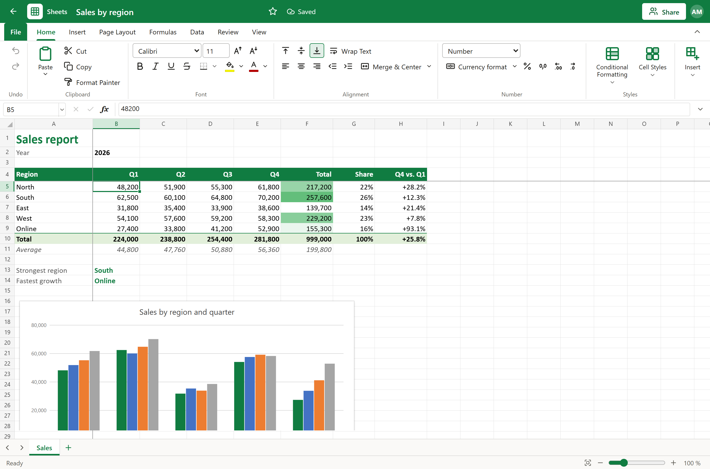
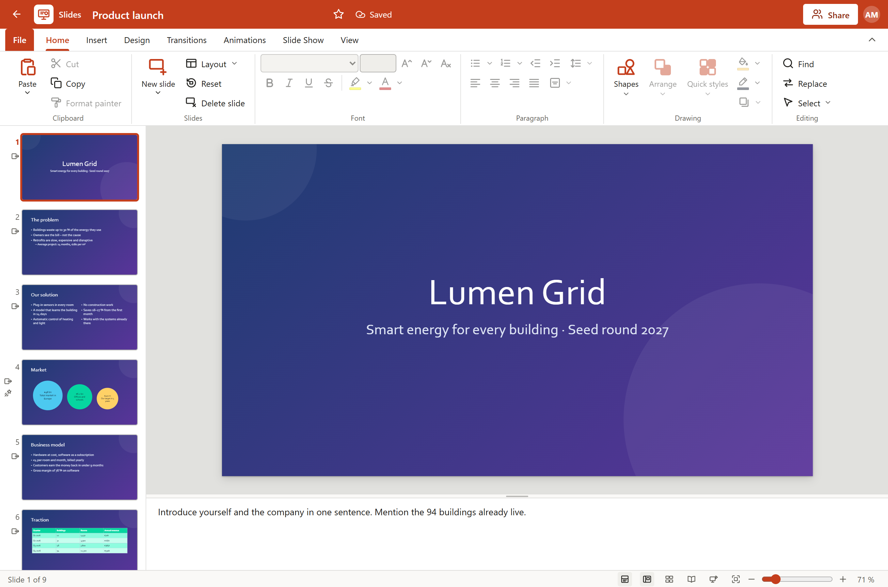
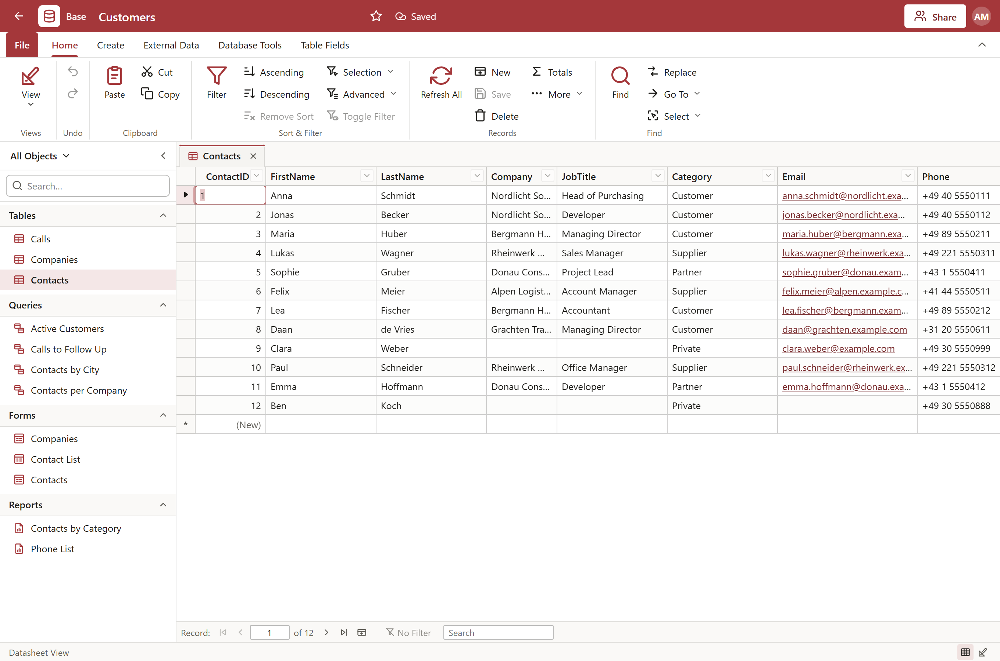

<div align="center">


# MatOffice

**Office in the browser – four apps in one.**

Docs, Sheets, Slides and Base: write, calculate, present and organise, with Word, Excel and PowerPoint files.
Self-hosted, one container plus PostgreSQL.

</div>



---

## The apps

| App | Like | Files |
|---|---|---|
| **Docs** | Word | `.docx`, HTML, Markdown, text, the own `.matdoc` |
| **Sheets** | Excel | `.xlsx`, `.csv`, `.tsv`, the own `.matsheet` |
| **Slides** | PowerPoint | `.pptx`, the own `.matslides`; PDF by printing |
| **Base** | Access | the own `.matbase`; tables from and to Excel and CSV |

All four share one frame: the title bar in the colour of the app, the ribbon with its tabs, **File** (info, new, open, save a copy, download as, print,
share, version history), autosave with conflict handling, a version history, sharing with people and through a link, the trash, offline use.
English and German, light and dark, and a phone layout.

<p align="center"></p>

**Docs** – pages like Word (size, orientation, margins, columns, headers and footers with page numbers), a gallery of styles, fonts and paragraphs,
bullets, numbering and multilevel lists, tables (merge, split, styles, column widths), pictures with wrapping, links, a table of contents, footnotes,
comments with replies, find and replace, word count, print and PDF. Templates: letter, report, meeting notes, résumé, proposal, invoice.



**Sheets** – a grid like Excel (frozen panes, merged cells, borders, wrapping, conditional formats, notes), a formula engine with 324 functions
(German `;` and decimal comma are understood), number formats, fill series, sort and filter, data validation, names, charts, pictures, sheet tabs,
print. Templates: budget, invoice, schedule, sales, tasks, loan.



**Slides** – thumbnails, layouts with placeholders, designs and their variants, shapes, pictures and tables, transitions and animations, the slide
show (F5) with a presenter view, speaker notes, the slide sorter, print (slides, notes pages, handouts) and a slide as PNG. Templates: pitch deck,
project status, workshop, quarterly review, photo album.



**Base** – the navigation pane, tables in datasheet and design view (field types, validation, lookups), relationships with referential integrity,
queries in the design grid and in SQL (parameters, totals, action queries), forms (single, continuous, datasheet, split, with subforms), reports with
grouping, totals and a print preview, the wizards for queries, forms and reports, and Excel and CSV import and export.



## Quick start

```yaml
name: matoffice

services:
  web:
    image: ghcr.io/real-ttx/matoffice:latest
    restart: unless-stopped
    ports:
      - "4820:4820"
    volumes:
      - web-data:/data
    depends_on:
      db:
        condition: service_healthy

  db:
    image: postgres:17
    restart: unless-stopped
    environment:
      POSTGRES_DB: matoffice
      POSTGRES_USER: matoffice
      POSTGRES_PASSWORD: matoffice
    volumes:
      - db-data:/var/lib/postgresql/data
    healthcheck:
      test: ["CMD-SHELL", "pg_isready -U matoffice -d matoffice"]
      interval: 5s
      timeout: 5s
      retries: 20

volumes:
  web-data:
  db-data:
```

Open **http://localhost:4820**; the first account that registers is the administrator.

| Tag | Built from |
|---|---|
| `ghcr.io/real-ttx/matoffice:latest` | `main` (release) |
| `ghcr.io/real-ttx/matoffice:nightly` | `dev` (development) |

## Connected apps (MatDrive)

MatDrive opens the files MatOffice can read in it: Word, Excel, PowerPoint, CSV, text, Markdown, HTML and the MatOffice files. In MatOffice: *Administration → Connected apps → Connect an app*
makes an API key (shown once). In MatDrive: *Administration → Integrations*: switch on MatOffice, enter its address and the key (and, in Docker, the
internal addresses). *New* in MatDrive then makes a Word document, an Excel workbook, a PowerPoint presentation or a MatOffice database and opens it
here; every save goes back to MatDrive with the version of the file as condition (a file that changed there meanwhile is not overwritten). The
access token of MatDrive never reaches a browser. Details in [docs/EDITORS.md](docs/EDITORS.md) and in the `HostEndpoints` (`/api/v1/host/formats`,
`/api/v1/host/new`, `/api/v1/host/sessions`).

## Mat platform

`/api` (description), `/api/health`, `/api/state`, `/api/configure`, `/api/actions` after the platform contract of MatDesign (`MAT_API_KEY` or a token of
MatIdentity); sign-in through MatIdentity (`MATIDENTITY_AUTHORITY`, `MATIDENTITY_CLIENT_ID`, `MATIDENTITY_CLIENT_SECRET`, `MATIDENTITY_INTERNAL_URL`),
mail through MatSMTP (`MATSMTP_HOST` …). All optional, set by Mattiverse.

## Development

```bash
docker compose -f docker-compose.local.yml up -d --build    # http://localhost:4820, pgAdmin http://localhost:4821
dotnet build MatOffice.slnx
dotnet test MatOffice.slnx                                  # database tests with MATOFFICE_TEST_DB (see CLAUDE.md)
node --test "tests/js/**/*.test.mjs"                        # the pure modules of the editors (formula engine, expressions, models)
```

`./scripts/redeploy.ps1` rebuilds the local stack (`-Clean` for empty volumes). The contract between the shared frame and the four editors, and the
content format of each app: [docs/EDITORS.md](docs/EDITORS.md). Conventions and the map of the code: [CLAUDE.md](CLAUDE.md).

## Branches & versioning

| Branch | Purpose | Version |
|---|---|---|
| `main` | Release | `<major>.<minor>.<build>-<yyyyMMdd>` |
| `dev` | Development | `nightly-<build>-<yyyyMMdd>` |
| local | – | `local-<yyyyMMdd>` |
